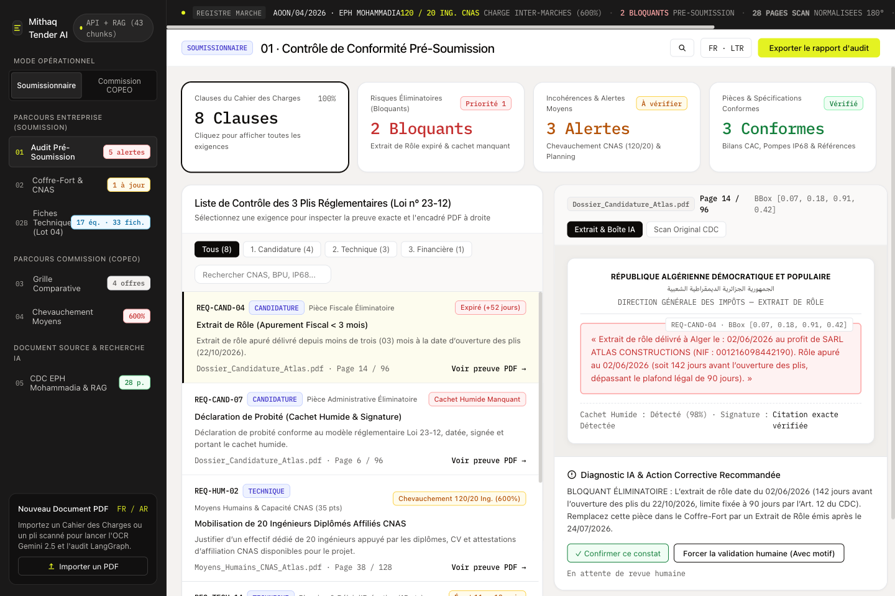
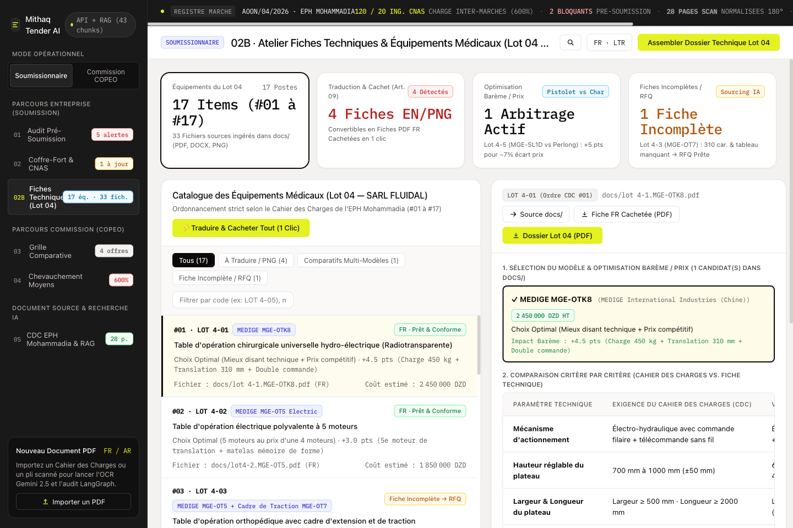
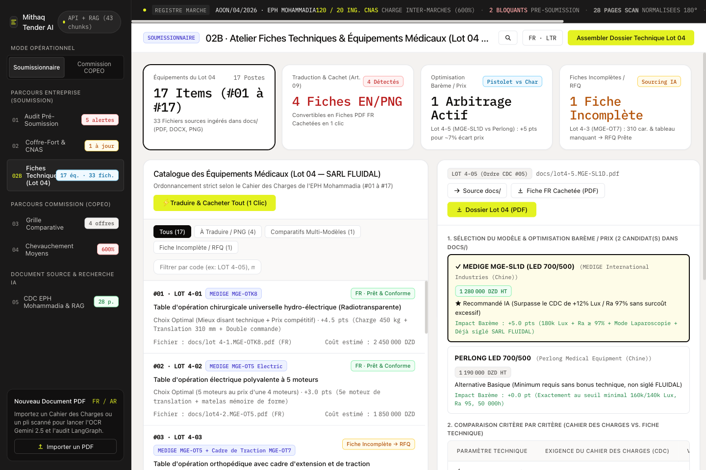
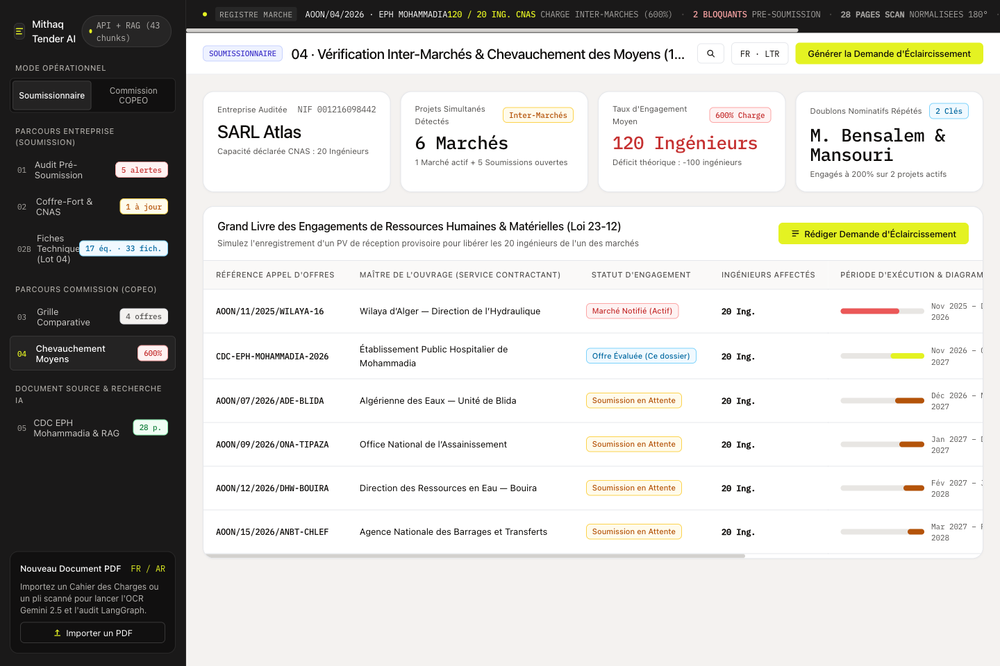
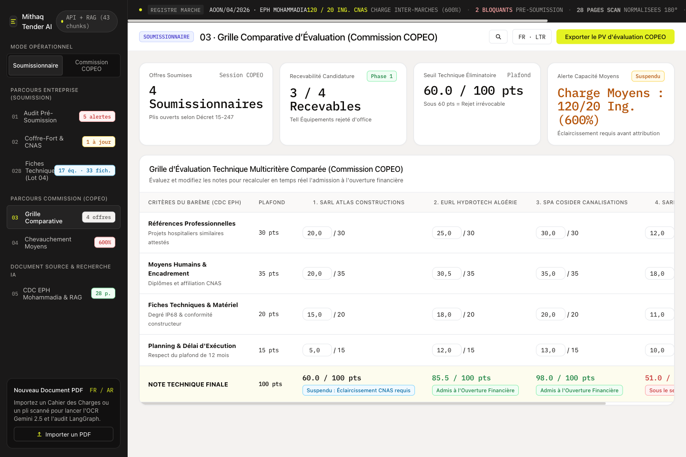
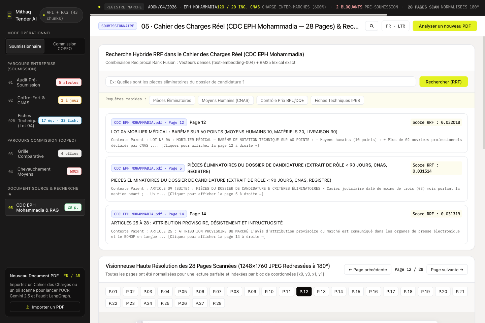

# Tender AI Platform

An automated public procurement compliance auditing and technical bid preparation platform for public tenders (Loi n° 23-12 & Décret 15-247).

## Architecture & Features

- **Bilingual Ingestion & Vision-OCR**: Extracts text, tables, wet stamps, and signatures from scanned and digital PDFs in French and Arabic, with automatic 180° orientation correction.
- **Hierarchical Parent-Child Chunking**: Preserves legal context across clauses, sub-clauses, and technical specification tables.
- **Hybrid RRF Retrieval**: Combines dense vector semantic search with BM25 lexical keyword matching via Reciprocal Rank Fusion.
- **Deterministic Regulatory Validators**:
  - Fiscal & parafiscal certificate age verification (Extrait de rôle, CNAS < 90 days).
  - Financial consistency checks (BPU amounts in words vs. DQE numerical figures).
  - Cross-tender resource overlap ledger tracking committed personnel and machinery across concurrent tenders.
- **Technical Equipment Automation Engine**:
  - Parameter-by-parameter specification comparison against tender requirements.
  - Multi-candidate scoring (compliance rate, bonus technical specs, price competitiveness).
  - Automated supplier RFQ generation for missing or incomplete datasheets.
  - Translation of manufacturer datasheets (PDF/image) into standardized, company-branded French technical fiches with vector wet stamps.
  - Automated compilation of ordered technical dossiers matching the exact tender sequence.

## Screenshots & Workflows

### 1. Pre-Submission Regulatory Audit Matrix (Loi 23-12)
Validates mandatory administrative documents, highlights eliminatory blockers (expired Extrait de Rôle > 90 days, missing wet stamps), and verifies arithmetic BPU/DQE consistency.


### 2. Medical Equipment & Fiche Technique Automation (Lot 04)
Interactive workbench organizing equipment strictly by tender sequence, flagging language/stamp conditions, and managing procurement catalogs.


### 3. Multi-Candidate Sweet-Spot Optimizer
Side-by-side technical specification matching comparing candidate models against tender CPT requirements to balance bonus points vs unit costs.


### 4. Cross-Tender Resource Overlap Ledger & CNAS Tracker
Tracks committed personnel across multiple concurrent public bids against CNAS headcount to prevent over-allocation.


### 5. COPEO Evaluation Committee & Scoring Matrix
Official commission evaluation matrix ranking competing bidders and generating PDF evaluation procès-verbaux.


### 6. Bilingual Vision-OCR & Hybrid RRF Search
Scans 28 bilingual pages with auto-rotation, layout bounding boxes, and reciprocal rank fusion search across legal articles.


## Repository Structure

```
├── src/
│   ├── api_server.py                 # HTTP API server & static asset handler
│   ├── app.js                        # Frontend interactive workbench logic
│   ├── pdf_bilingual_ingest.py       # PDF parsing, OCR, and chunking pipeline
│   ├── hybrid_retriever.py           # Dense + BM25 RRF retriever
│   ├── tender_rag_graph.py           # Requirements extraction and audit graphs
│   ├── equipment_workflow_engine.py  # Technical specification comparison & PDF compiler
│   ├── test_full_workflow.py         # Test suite (55 integration tests)
│   ├── extracted_pages/              # Normalized page scans for the benchmark CDC
│   └── generated_fiches_fr/          # Compiled and stamped technical fiches
├── docs/                             # Catalog datasheets (.pdf, .docx, .png)
├── test_dossiers/                    # Sample procurement submission envelopes
├── index.html                        # Web workbench interface
├── requirements.txt                  # Python dependencies
├── Dockerfile                        # Container definition
├── docker-compose.yml                # Optional PostgreSQL (pgvector) + Redis stack
├── Procfile                          # Cloud process definition
├── render.yaml                       # Render deployment blueprint
└── .env.example                      # Environment variables template
```

## Getting Started

### Prerequisites

- Python 3.9+
- Optional: Docker / Docker Compose

### Local Setup

1. **Clone the repository**:
   ```bash
   git clone https://github.com/Aiden8teen/tender.git
   cd tender
   ```

2. **Create and activate a virtual environment**:
   ```bash
   python3 -m venv venv
   source venv/bin/activate
   ```

3. **Install dependencies**:
   ```bash
   pip install -r requirements.txt
   ```

4. **Configure environment variables**:
   ```bash
   cp .env.example .env
   ```
   Edit `.env` to set your `GEMINI_API_KEY` (optional if using pre-extracted benchmark data).

5. **Start the server**:
   ```bash
   python3 src/api_server.py --port 8000
   ```
   Open `http://localhost:8000` in your browser.

## Running Tests

The test suite runs completely offline and validates document ingestion, hybrid retrieval, deterministic math/date validators, LangGraph workflows, PDF generation, API endpoints, and production security rules:

```bash
python3 src/test_full_workflow.py
```

Expected output:
```text
VERIFICATION COMPLETE: 55 PASSED · 0 FAILED (100% SUCCESS)
```

## Docker Deployment

Build and run with Docker:

```bash
docker build -t tender-platform .
docker run -p 8000:8000 -e PORT=8000 tender-platform
```

Or start the optional PostgreSQL/pgvector and Redis infrastructure:

```bash
docker-compose up -d
```

## API Endpoints

| Method | Endpoint | Description |
| :--- | :--- | :--- |
| `GET` | `/api/v1/health` | Service health, model info, and chunk statistics |
| `GET` | `/api/v1/tenders/state` | Current tender audit state, COPEO matrix & overlap ledger |
| `GET` | `/api/v1/equipment/workflow` | Full technical equipment workflow and catalog state |
| `GET` | `/api/v1/export/audit-report` | Downloads Pre-Submission Audit Report PDF |
| `GET` | `/api/v1/export/copeo-pv` | Downloads COPEO Evaluation Committee PV PDF |
| `GET` | `/api/v1/export/translated-fiche?item=<CODE>` | Generates stamped French technical fiche PDF |
| `GET` | `/api/v1/export/dossier-technique-lot4` | Compiles sequential technical dossier PDF |
| `POST` | `/api/v1/rag/hybrid-search` | Executes Hybrid RRF search (`query`, `top_k`, `envelope`) |
| `POST` | `/api/v1/tenders/upload-and-analyze` | Runs complete audit pipeline on uploaded tender |
| `POST` | `/api/v1/audit/decision` | Records manual auditor confirmation or override |
| `POST` | `/api/v1/overlap/reconcile` | Reconciles resource commitment via provisional PV |
| `POST` | `/api/v1/equipment/select-candidate` | Selects equipment model for tender item |
| `POST` | `/api/v1/equipment/translate-all` | Batch-translates and stamps all technical fiches |
| `POST` | `/api/v1/equipment/upload-fiche` | Ingests new supplier datasheet with resale margins |
